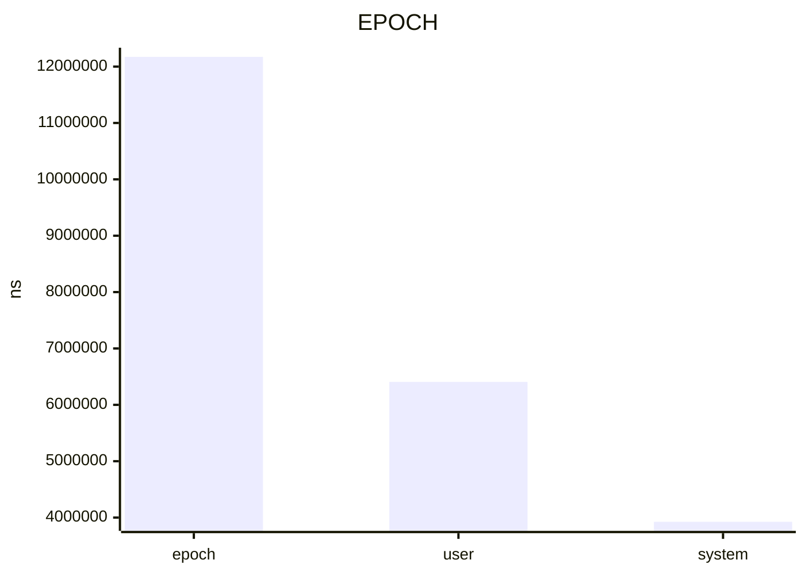

## epoch

+--------+-------+---------------------+-------------------+------------+---------------------+-------+------+--------------------------------------------------------------------------------------------------+---------------------+--------------------+----------------------+
| key    | type  | value               | errorPercent      | min        | max                 | calls | unit | samples                                                                                          | baseline            | change             | probability          |
+========+=======+=====================+===================+============+=====================+=======+======+==================================================================================================+=====================+====================+======================+
| epoch  | float | 1.217291666666667e7 | 4.082149580694844 | 1.136975e7 | 1.894633333333333e7 | 1     | ns   | 1.894633333333333e7, 1.5162625e7, 1.3466                                                         | 4.681195833333334e7 | -73.99613880712461 | 0.2785986718379627   |
|        |       |                     |                   |            |                     |       |      | 54166666667e7, 1.251983333333333e7, 1.21                                                         |                     |                    |                      |
|        |       |                     |                   |            |                     |       |      | 7291666666667e7, 1.136975e7, 1.150708333                                                         |                     |                    |                      |
|        |       |                     |                   |            |                     |       |      | 333333e7, 1.1676e7, 1.188675e7, 1.248604                                                         |                     |                    |                      |
|        |       |                     |                   |            |                     |       |      | 166666667e7, 1.215545833333333e7                                                                 |                     |                    |                      |
+--------+-------+---------------------+-------------------+------------+---------------------+-------+------+--------------------------------------------------------------------------------------------------+---------------------+--------------------+----------------------+
| user   | float | 6.406e6             | 5.198251639088355 | 5.918e6    | 9.976e6             | 1     | ns   | 9.976e6, 8.166e6, 7.142e6, 6.688e6, 6.406e6, 5.918e6, 5.975e6, 6.073e6, 6.132e6, 6.517e6, 6.16e6 | 4.2152e7            | -84.80261909280699 | 0.01146807302223756  |
+--------+-------+---------------------+-------------------+------------+---------------------+-------+------+--------------------------------------------------------------------------------------------------+---------------------+--------------------+----------------------+
| system | float | 3.925e6             | 4.917197452229299 | 3.569e6    | 5.84e6              | 1     | ns   | 5.84e6, 4.687e6, 4.177e6, 3.925e6, 3.865e6, 3.569e6, 3.705e6, 3.732e6, 3.834e6, 4.032e6, 4.003e6 | 3.02e6              | 29.96688741721854  | 0.009493054145363066 |
+--------+-------+---------------------+-------------------+------------+---------------------+-------+------+--------------------------------------------------------------------------------------------------+---------------------+--------------------+----------------------+

