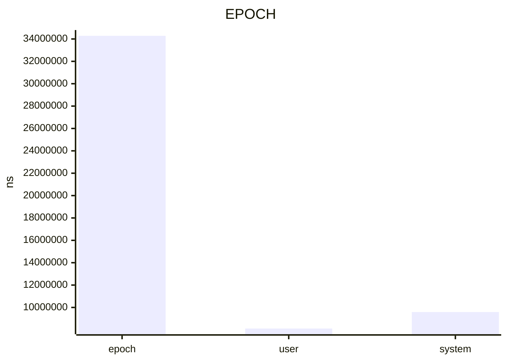

## epoch

+--------+-------+---------------------+-------------------+---------------------+---------------------+-------+------+------------------------------------------+---------------------+--------------------+-----------------------+
| key    | type  | value               | errorPercent      | min                 | max                 | calls | unit | samples                                  | baseline            | change             | probability           |
+========+=======+=====================+===================+=====================+=====================+=======+======+==========================================+=====================+====================+=======================+
| epoch  | float | 3.428491666666666e7 | 13.40895777783718 | 2.837108333333334e7 | 4.433070833333334e7 | 1     | ns   | 3.171175e7, 2.837108333333334e7, 3.42849 | 4.681195833333334e7 | -26.76034524654048 | 0.2785986718379627    |
|        |       |                     |                   |                     |                     |       |      | 1666666666e7, 2.843079166666667e7, 4.240 |                     |                    |                       |
|        |       |                     |                   |                     |                     |       |      | 658333333333e7, 4.433070833333334e7, 4.0 |                     |                    |                       |
|        |       |                     |                   |                     |                     |       |      | 52575e7, 2.968766666666667e7, 3.69104166 |                     |                    |                       |
|        |       |                     |                   |                     |                     |       |      | 6666666e7, 3.5139875e7, 3.33229166666666 |                     |                    |                       |
|        |       |                     |                   |                     |                     |       |      | 7e7                                      |                     |                    |                       |
+--------+-------+---------------------+-------------------+---------------------+---------------------+-------+------+------------------------------------------+---------------------+--------------------+-----------------------+
| user   | float | 8.117e6             | 14.42651225822348 | 6.35e6              | 1.1069e7            | 1     | ns   | 1.1069e7, 8.862e6, 8.046e6, 9.732e6, 7.0 | 4.2152e7            | -80.74349971531601 | 0.01146807302223756   |
|        |       |                     |                   |                     |                     |       |      | 99e6, 8.117e6, 7.577e6, 9.737e6, 9.735e6 |                     |                    |                       |
|        |       |                     |                   |                     |                     |       |      | , 6.35e6, 6.946e6                        |                     |                    |                       |
+--------+-------+---------------------+-------------------+---------------------+---------------------+-------+------+------------------------------------------+---------------------+--------------------+-----------------------+
| system | float | 9.593e6             | 5.587407484624205 | 8.146e6             | 1.1714e7            | 1     | ns   | 1.1331e7, 9.593e6, 9.686e6, 1.0045e7, 8. | 3.02e6              | 217.6490066225166  | 0.0007202617099102228 |
|        |       |                     |                   |                     |                     |       |      | 146e6, 9.373e6, 8.484e6, 9.895e6, 1.1714 |                     |                    |                       |
|        |       |                     |                   |                     |                     |       |      | e7, 8.291e6, 9.057e6                     |                     |                    |                       |
+--------+-------+---------------------+-------------------+---------------------+---------------------+-------+------+------------------------------------------+---------------------+--------------------+-----------------------+

