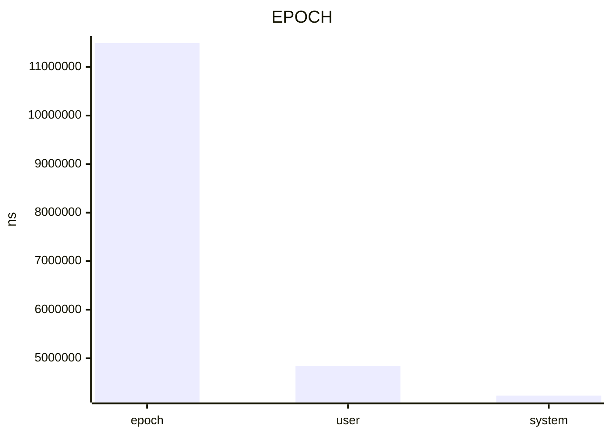

## epoch

+--------+-------+-------------+-------------------+---------------------+-------------+-------+------+------------------------------------------------------------------------------------------------------------------------------------------------------------------------------------------------------+---------------------+--------------------+----------------------+
| key    | type  | value       | errorPercent      | min                 | max         | calls | unit | samples                                                                                                                                                                                              | baseline            | change             | probability          |
+========+=======+=============+===================+=====================+=============+=======+======+======================================================================================================================================================================================================+=====================+====================+======================+
| epoch  | float | 1.1492875e7 | 2.122691957698418 | 1.099941666666667e7 | 1.6213125e7 | 1     | ns   | 1.6213125e7, 1.185058333333333e7, 1.2083375e7, 1.151958333333333e7, 1.147925e7, 1.1492875e7, 1.127754166666667e7, 1.110908333333333e7, 1.149354166666667e7, 1.124891666666667e7, 1.099941666666667e7 | 1.451766666666667e7 | -20.83524671090397 | 0.490519611041511    |
+--------+-------+-------------+-------------------+---------------------+-------------+-------+------+------------------------------------------------------------------------------------------------------------------------------------------------------------------------------------------------------+---------------------+--------------------+----------------------+
| user   | float | 4.839e6     | 1.467245298615417 | 4.748e6             | 5.219e6     | 1     | ns   | 5.219e6, 5.098e6, 5.052e6, 4.956e6, 4.849e6, 4.768e6, 4.826e6, 4.839e6, 4.813e6, 4.809e6, 4.748e6                                                                                                    | 1.0304e7            | -53.03765527950311 | 0.01146807302223756  |
+--------+-------+-------------+-------------------+---------------------+-------------+-------+------+------------------------------------------------------------------------------------------------------------------------------------------------------------------------------------------------------+---------------------+--------------------+----------------------+
| system | float | 4.229e6     | 3.121305273114211 | 4.075e6             | 5.142e6     | 1     | ns   | 5.142e6, 4.503e6, 4.432e6, 4.267e6, 4.229e6, 4.097e6, 4.086e6, 4.229e6, 4.178e6, 4.075e6, 4.348e6                                                                                                    | 2.648e6             | 59.70543806646526  | 0.001152354817319397 |
+--------+-------+-------------+-------------------+---------------------+-------------+-------+------+------------------------------------------------------------------------------------------------------------------------------------------------------------------------------------------------------+---------------------+--------------------+----------------------+

