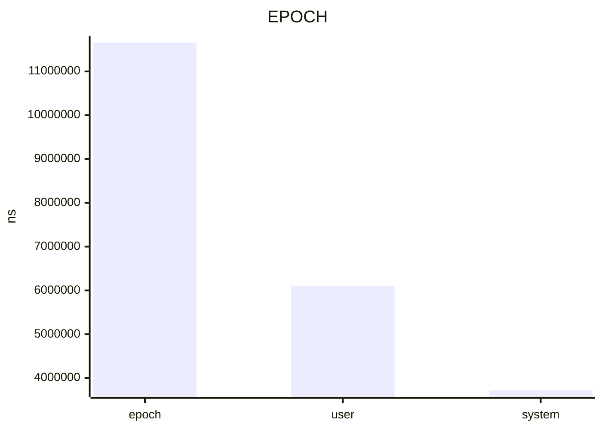

## epoch

+--------+-------+-------------+-------------------+---------------------+---------------------+-------+------+---------------------------------------------------------------------------------------------------+---------------------+--------------------+----------------------+
| key    | type  | value       | errorPercent      | min                 | max                 | calls | unit | samples                                                                                           | baseline            | change             | probability          |
+========+=======+=============+===================+=====================+=====================+=======+======+===================================================================================================+=====================+====================+======================+
| epoch  | float | 1.1660625e7 | 3.143413553447315 | 1.121141666666667e7 | 1.862341666666667e7 | 1     | ns   | 1.862341666666667e7, 1.493404166666667e7                                                          | 1.451766666666667e7 | -19.67975799600488 | 0.9215372441867455   |
|        |       |             |                   |                     |                     |       |      | , 1.488879166666667e7, 1.290366666666667                                                          |                     |                    |                      |
|        |       |             |                   |                     |                     |       |      | e7, 1.1967625e7, 1.1660625e7, 1.15019166                                                          |                     |                    |                      |
|        |       |             |                   |                     |                     |       |      | 6666667e7, 1.159675e7, 1.121141666666667                                                          |                     |                    |                      |
|        |       |             |                   |                     |                     |       |      | e7, 1.134e7, 1.129408333333333e7                                                                  |                     |                    |                      |
+--------+-------+-------------+-------------------+---------------------+---------------------+-------+------+---------------------------------------------------------------------------------------------------+---------------------+--------------------+----------------------+
| user   | float | 6.109e6     | 3.290227533147815 | 5.887e6             | 9.852e6             | 1     | ns   | 9.852e6, 7.988e6, 7.634e6, 6.708e6, 6.20                                                          | 1.0304e7            | -40.71234472049689 | 0.01654017185597306  |
|        |       |             |                   |                     |                     |       |      | 5e6, 6.109e6, 5.98e6, 5.97e6, 5.887e6, 5                                                          |                     |                    |                      |
|        |       |             |                   |                     |                     |       |      | .914e6, 5.908e6                                                                                   |                     |                    |                      |
+--------+-------+-------------+-------------------+---------------------+---------------------+-------+------+---------------------------------------------------------------------------------------------------+---------------------+--------------------+----------------------+
| system | float | 3.721e6     | 3.547433485622145 | 3.574e6             | 6.072e6             | 1     | ns   | 6.072e6, 4.717e6, 4.902e6, 4.102e6, 3.796e6, 3.711e6, 3.721e6, 3.697e6, 3.589e6, 3.639e6, 3.574e6 | 2.648e6             | 40.52114803625378  | 0.001152354817319397 |
+--------+-------+-------------+-------------------+---------------------+---------------------+-------+------+---------------------------------------------------------------------------------------------------+---------------------+--------------------+----------------------+

