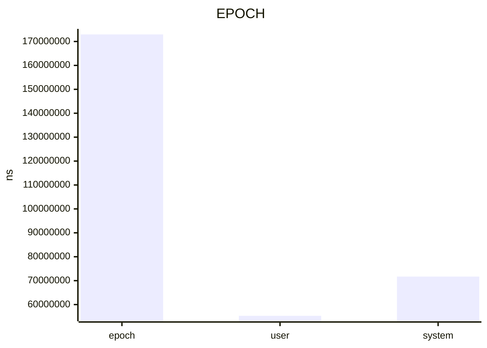

## epoch

+--------+-------+-------------+--------------------+----------+--------------+-------+------+------------------------------------------+---------------+--------------------+------------------------+
| key    | type  | value       | errorPercent       | min      | max          | calls | unit | samples                                  | baseline      | change             | probability            |
+========+=======+=============+====================+==========+==============+=======+======+==========================================+===============+====================+========================+
| epoch  | float | 1.7296425e8 | 1.037425363911907  | 1.7091e8 | 1.89024125e8 | 1     | ns   | 1.89024125e8, 1.769168333333333e8, 1.711 | 1.600147625e9 | -89.1907316988956  | 0.00007105263288600171 |
|        |       |             |                    |          |              |       |      | 69875e8, 1.7091e8, 1.71178375e8, 1.78193 |               |                    |                        |
|        |       |             |                    |          |              |       |      | 8333333333e8, 1.7296425e8, 1.75486958333 |               |                    |                        |
|        |       |             |                    |          |              |       |      | 3333e8, 1.71668375e8, 1.724863333333333e |               |                    |                        |
|        |       |             |                    |          |              |       |      | 8, 1.74255e8                             |               |                    |                        |
+--------+-------+-------------+--------------------+----------+--------------+-------+------+------------------------------------------+---------------+--------------------+------------------------+
| user   | float | 5.53e7      | 0.6528028933092224 | 5.4939e7 | 5.8745e7     | 1     | ns   | 5.8745e7, 5.6475e7, 5.53e7, 5.5142e7, 5. | 3.65648e8     | -84.87616505491621 | 0.01146807302223756    |
|        |       |             |                    |          |              |       |      | 5151e7, 5.6601e7, 5.4939e7, 5.6029e7, 5. |               |                    |                        |
|        |       |             |                    |          |              |       |      | 5228e7, 5.5141e7, 5.5901e7               |               |                    |                        |
+--------+-------+-------------+--------------------+----------+--------------+-------+------+------------------------------------------+---------------+--------------------+------------------------+
| system | float | 7.1706e7    | 1.524279697654311  | 6.9777e7 | 7.68e7       | 1     | ns   | 7.68e7, 7.3059e7, 7.0613e7, 7.0337e7, 7. | 7.2199e8      | -90.06828349423122 | 0.01146807302223756    |
|        |       |             |                    |          |              |       |      | 116e7, 7.2898e7, 7.1718e7, 7.2564e7, 6.9 |               |                    |                        |
|        |       |             |                    |          |              |       |      | 777e7, 7.1334e7, 7.1706e7                |               |                    |                        |
+--------+-------+-------------+--------------------+----------+--------------+-------+------+------------------------------------------+---------------+--------------------+------------------------+

