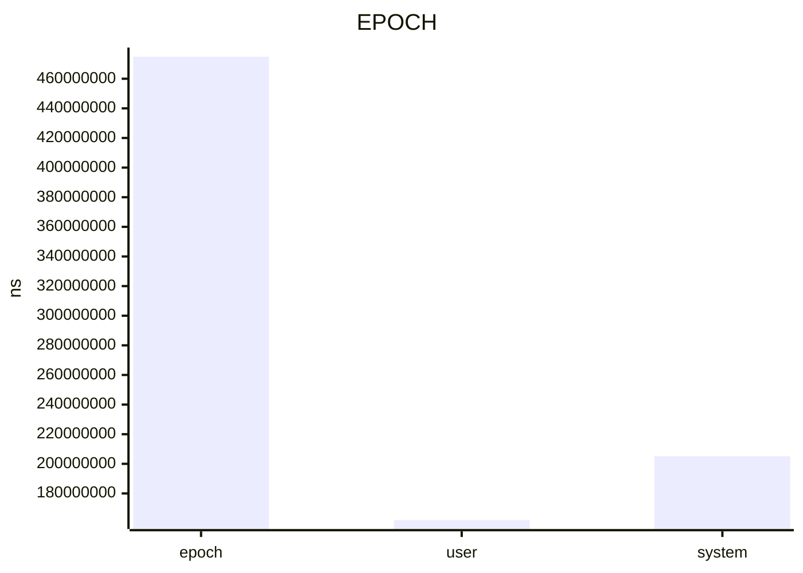

## epoch

+--------+-------+---------------------+--------------------+--------------+---------------------+-------+------+-------------------------------------------------------------------------------------------------------------------------------------------------------------------------------------------------------+---------------------+-------------------+------------------------+
| key    | type  | value               | errorPercent       | min          | max                 | calls | unit | samples                                                                                                                                                                                               | baseline            | change            | probability            |
+========+=======+=====================+====================+==============+=====================+=======+======+=======================================================================================================================================================================================================+=====================+===================+========================+
| epoch  | float | 4.749114166666666e8 | 0.7731090903444008 | 4.67727875e8 | 7.922455833333333e8 | 1     | ns   | 7.922455833333333e8, 4.67727875e8, 4.78583e8, 4.705020416666666e8, 4.7627675e8, 4.710128333333333e8, 4.753174583333333e8, 4.749114166666666e8, 4.784507083333333e8, 4.71030625e8, 4.742437916666667e8 | 1.661634583333333e8 | 185.8097811818333 | 0.00007105263288600171 |
+--------+-------+---------------------+--------------------+--------------+---------------------+-------+------+-------------------------------------------------------------------------------------------------------------------------------------------------------------------------------------------------------+---------------------+-------------------+------------------------+
| user   | float | 1.62077e8           | 0.8446602540767659 | 1.58883e8    | 1.77745e8           | 1     | ns   | 1.77745e8, 1.58883e8, 1.64367e8, 1.60661                                                                                                                                                              | 3.9088e7            | 314.6464388047482 | 0.00007105263288600171 |
|        |       |                     |                    |              |                     |       |      | e8, 1.62077e8, 1.59262e8, 1.62658e8, 1.6                                                                                                                                                              |                     |                   |                        |
|        |       |                     |                    |              |                     |       |      | 0708e8, 1.62975e8, 1.60716e8, 1.62192e8                                                                                                                                                               |                     |                   |                        |
+--------+-------+---------------------+--------------------+--------------+---------------------+-------+------+-------------------------------------------------------------------------------------------------------------------------------------------------------------------------------------------------------+---------------------+-------------------+------------------------+
| system | float | 2.05062e8           | 0.8968019428270474 | 2.0171e8     | 2.23217e8           | 1     | ns   | 2.23217e8, 2.0171e8, 2.06901e8, 2.02283e                                                                                                                                                              | 7.3408e7            | 179.3455754141238 | 0.00007105263288600171 |
|        |       |                     |                    |              |                     |       |      | 8, 2.04663e8, 2.03616e8, 2.05298e8, 2.05                                                                                                                                                              |                     |                   |                        |
|        |       |                     |                    |              |                     |       |      | 446e8, 2.07031e8, 2.03034e8, 2.05062e8                                                                                                                                                                |                     |                   |                        |
+--------+-------+---------------------+--------------------+--------------+---------------------+-------+------+-------------------------------------------------------------------------------------------------------------------------------------------------------------------------------------------------------+---------------------+-------------------+------------------------+

