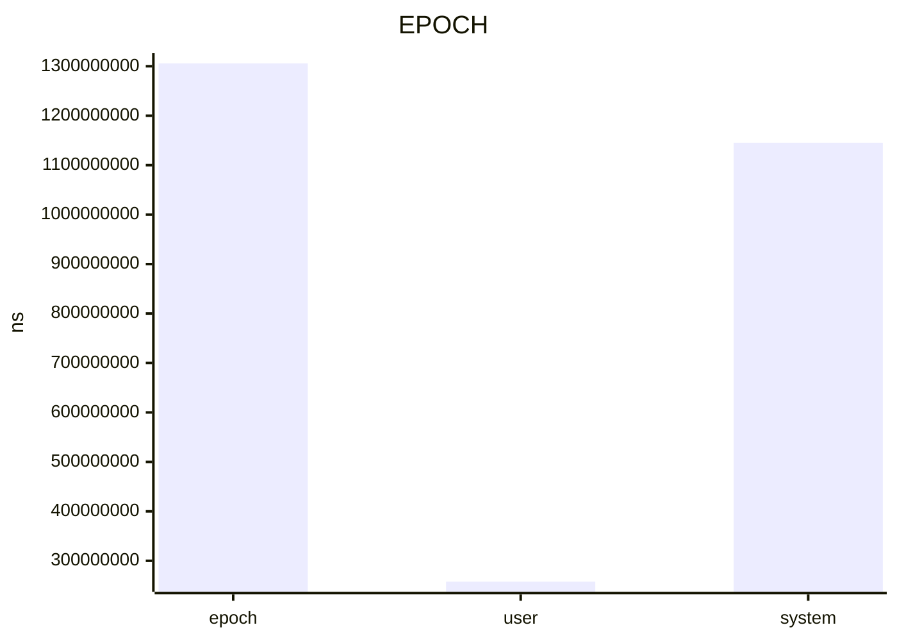

## epoch

+--------+-------+------------+--------------------+--------------+---------------+-------+------+------------------------------------------------------------------------------------------------------------------------------------+---------------------+--------------------+------------------------+
| key    | type  | value      | errorPercent       | min          | max           | calls | unit | samples                                                                                                                            | baseline            | change             | probability            |
+========+=======+============+====================+==============+===============+=======+======+====================================================================================================================================+=====================+====================+========================+
| epoch  | float | 1.305832e9 | 0.4652014960576858 | 1.27828625e9 | 1.314029125e9 | 1     | ns   | 1.27828625e9, 1.306644208333333e9, 1.293                                                                                           | 9.326237541666666e9 | -85.99829787557996 | 0.7179816667337767     |
|        |       |            |                    |              |               |       |      | 906208333333e9, 1.311293583333333e9, 1.2                                                                                           |                     |                    |                        |
|        |       |            |                    |              |               |       |      | 92607458333333e9, 1.309862541666667e9, 1                                                                                           |                     |                    |                        |
|        |       |            |                    |              |               |       |      | .288101208333333e9, 1.305832e9, 1.299757                                                                                           |                     |                    |                        |
|        |       |            |                    |              |               |       |      | 25e9, 1.314029125e9, 1.309737833333333e9                                                                                           |                     |                    |                        |
+--------+-------+------------+--------------------+--------------+---------------+-------+------+------------------------------------------------------------------------------------------------------------------------------------+---------------------+--------------------+------------------------+
| user   | float | 2.57734e8  | 0.5494036487231021 | 2.53337e8    | 2.63175e8     | 1     | ns   | 2.53337e8, 2.56318e8, 2.60872e8, 2.53977                                                                                           | 2.832804e9          | -90.90180612566206 | 0.00007105263288600171 |
|        |       |            |                    |              |               |       |      | e8, 2.56885e8, 2.59387e8, 2.57992e8, 2.5                                                                                           |                     |                    |                        |
|        |       |            |                    |              |               |       |      | 7734e8, 2.63175e8, 2.57269e8, 2.58668e8                                                                                            |                     |                    |                        |
+--------+-------+------------+--------------------+--------------+---------------+-------+------+------------------------------------------------------------------------------------------------------------------------------------+---------------------+--------------------+------------------------+
| system | float | 1.145219e9 | 0.5708951737615251 | 1.112866e9   | 1.155986e9    | 1     | ns   | 1.112866e9, 1.136474e9, 1.134574e9, 1.149022e9, 1.140994e9, 1.151757e9, 1.137981e9, 1.148759e9, 1.149021e9, 1.145219e9, 1.155986e9 | 4.774835e9          | -76.01552723811399 | 0.00007105263288600171 |
+--------+-------+------------+--------------------+--------------+---------------+-------+------+------------------------------------------------------------------------------------------------------------------------------------+---------------------+--------------------+------------------------+

