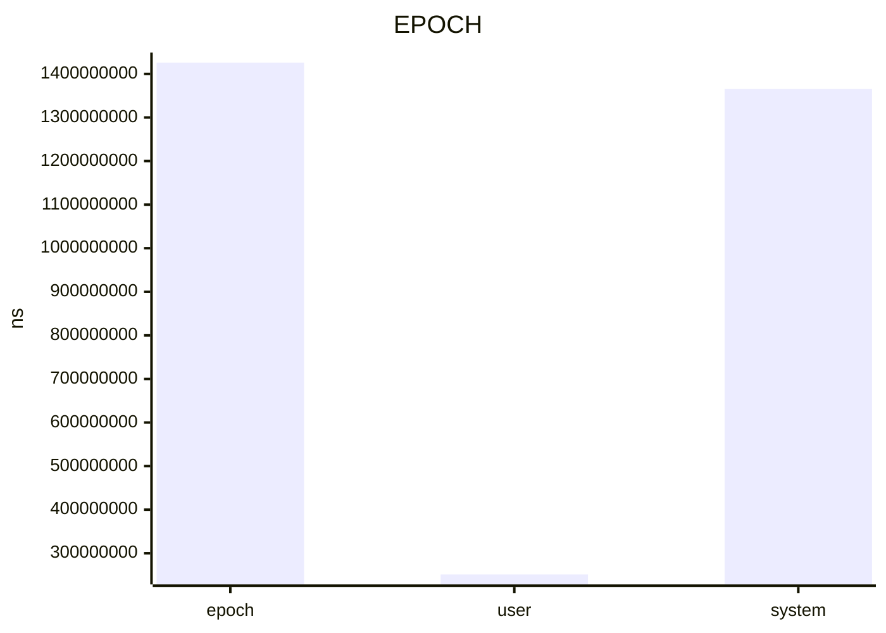

## epoch

+--------+-------+---------------------+--------------------+---------------------+---------------------+-------+------+------------------------------------------------------------------------------------------------------------------------------------+---------------------+--------------------+---------------------+
| key    | type  | value               | errorPercent       | min                 | max                 | calls | unit | samples                                                                                                                            | baseline            | change             | probability         |
+========+=======+=====================+====================+=====================+=====================+=======+======+====================================================================================================================================+=====================+====================+=====================+
| epoch  | float | 1.426010166666667e9 | 0.8658277447998448 | 1.396086333333333e9 | 1.445192958333333e9 | 1     | ns   | 1.419965541666667e9, 1.426010166666667e9                                                                                           | 2.123767458333333e9 | -32.85469362141205 | 0.7179816667337767  |
|        |       |                     |                    |                     |                     |       |      | , 1.42612075e9, 1.438356958333333e9, 1.4                                                                                           |                     |                    |                     |
|        |       |                     |                    |                     |                     |       |      | 37962458333333e9, 1.445192958333333e9, 1                                                                                           |                     |                    |                     |
|        |       |                     |                    |                     |                     |       |      | .401108e9, 1.397111166666667e9, 1.396086                                                                                           |                     |                    |                     |
|        |       |                     |                    |                     |                     |       |      | 333333333e9, 1.413453916666667e9, 1.4372                                                                                           |                     |                    |                     |
|        |       |                     |                    |                     |                     |       |      | 28333333333e9                                                                                                                      |                     |                    |                     |
+--------+-------+---------------------+--------------------+---------------------+---------------------+-------+------+------------------------------------------------------------------------------------------------------------------------------------+---------------------+--------------------+---------------------+
| user   | float | 2.51364e8           | 0.5585525373561846 | 2.45254e8           | 2.56042e8           | 1     | ns   | 2.48776e8, 2.52245e8, 2.56042e8, 2.52455                                                                                           | 3.98935e8           | -36.99123917430158 | 0.01146807302223756 |
|        |       |                     |                    |                     |                     |       |      | e8, 2.503e8, 2.51364e8, 2.53112e8, 2.452                                                                                           |                     |                    |                     |
|        |       |                     |                    |                     |                     |       |      | 54e8, 2.4996e8, 2.52126e8, 2.49002e8                                                                                               |                     |                    |                     |
+--------+-------+---------------------+--------------------+---------------------+---------------------+-------+------+------------------------------------------------------------------------------------------------------------------------------------+---------------------+--------------------+---------------------+
| system | float | 1.365294e9          | 0.7468721022724776 | 1.278033e9          | 1.383251e9          | 1     | ns   | 1.348273e9, 1.365294e9, 1.375491e9, 1.368914e9, 1.383251e9, 1.360723e9, 1.336486e9, 1.278033e9, 1.336294e9, 1.366755e9, 1.373117e9 | 1.54711e9           | -11.75197626542392 | 0.07095149242730564 |
+--------+-------+---------------------+--------------------+---------------------+---------------------+-------+------+------------------------------------------------------------------------------------------------------------------------------------+---------------------+--------------------+---------------------+

